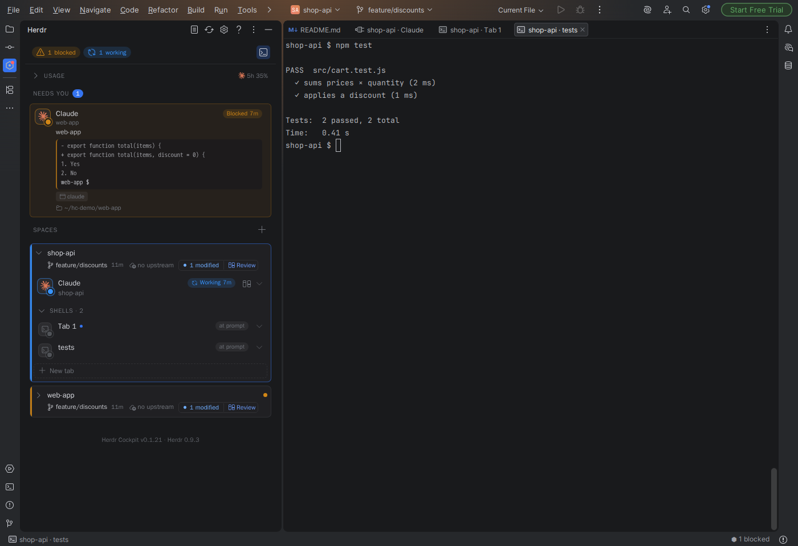
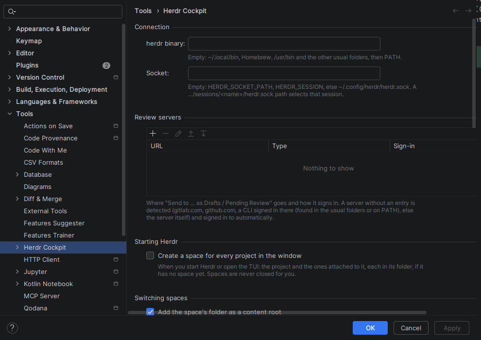
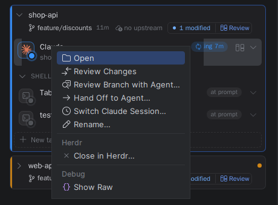
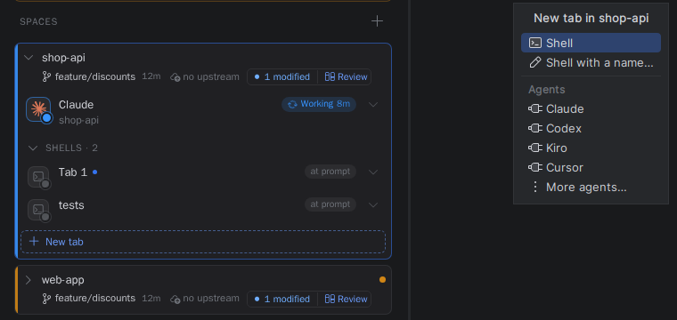
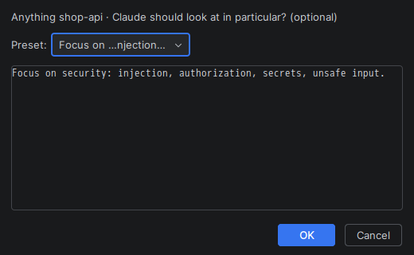
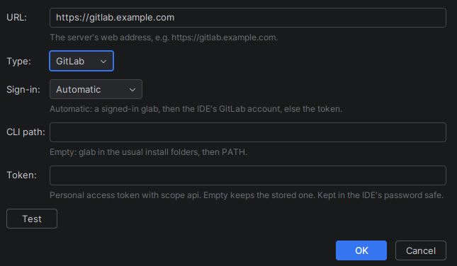
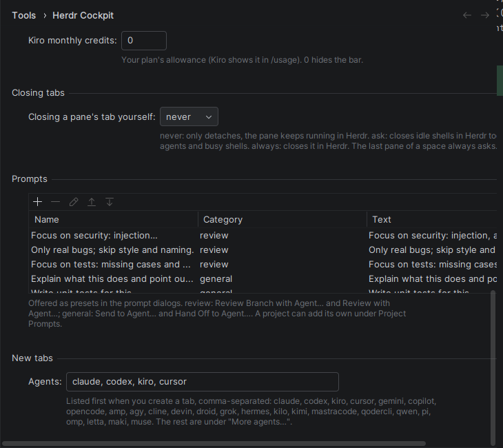
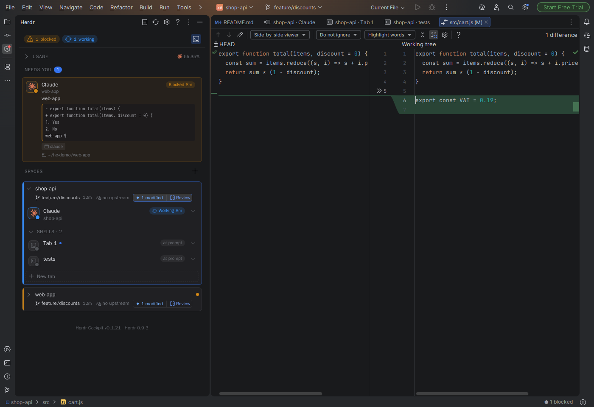

# Herdr Cockpit for JetBrains IDEs

A community (unofficial) client for [Herdr](https://herdr.dev) in PhpStorm and other JetBrains IDEs: Herdr's spaces,
agents and shells in the IDE. A port of [Herdr Cockpit for VS Code](https://github.com/sriharirao92/vscode-herdr-cockpit)
(MIT, see `LICENSE.upstream`). This port is MIT licensed too (`LICENSE`). The sidebar renderer (`media/panel.js`, `panel.css`), agent logos and codicons come
from that project unchanged (see `THIRD_PARTY_NOTICES.md`); `media/help.html` is adapted from its help page, and
`herdr-plugin/` reuses helpers of its Herdr plugin.

The plugin is a **client of the Herdr server**. It never owns agent processes; Herdr does.



## Requirements

| What | Version | Needed for |
|---|---|---|
| A JetBrains IDE | 2025.3 or newer (build 253+): PhpStorm, IntelliJ IDEA, WebStorm, PyCharm, GoLand, … | the plugin |
| [Herdr](https://herdr.dev) | 0.9.1 – 0.9.3 (socket protocol 22) | everything |
| git | any recent | the git line, Review, worktrees |
| macOS or Linux | | the plugin talks to Herdr's Unix socket; see [Windows](#windows) |
| `curl` or `wget` | | optional: the Herdr plugin (links from Herdr to the IDE) |
| `glab`, `gh`, `tea` | | optional: sending reviews to GitLab, GitHub, Gitea with the CLI's login |
| Coding agents | Claude Code, Codex, Kiro, Cursor, … | optional: whatever you want to run in Herdr |

## Installation

Four parts, in this order. Only 1 and 3 are required.

1. **Herdr** itself
2. Herdr's **agent integrations** and **agent skill** (recommended)
3. This **IDE plugin**
4. The **Herdr plugin** in `herdr-plugin/` (optional, for links from Herdr to the IDE)

### 1. Install Herdr

**macOS and Linux:**

```bash
curl -fsSL https://herdr.dev/install.sh | sh
herdr --version
```

The script installs to `~/.local/bin` (set `HERDR_INSTALL_DIR` for another folder) and warns when that folder isn't
on your PATH. Add it to your shell profile if needed:

```bash
export PATH="$HOME/.local/bin:$PATH"
```

The plugin also finds `herdr` without PATH, which matters when the IDE is started from the Dock or a desktop launcher
and gets a minimal PATH. It looks in these folders first:

| OS | Folders checked before PATH |
|---|---|
| macOS | `/opt/homebrew/bin`, `/usr/local/bin`, `~/.local/bin`, `~/.cargo/bin`, `~/.nix-profile/bin`, `/run/current-system/sw/bin` |
| Linux | `~/.local/bin`, `/usr/local/bin`, `/usr/bin`, `/home/linuxbrew/.linuxbrew/bin`, `~/.linuxbrew/bin`, `~/.cargo/bin`, `~/.nix-profile/bin`, `/run/current-system/sw/bin`, `/snap/bin` |

Elsewhere: set the path in *Settings | Tools | Herdr Cockpit | herdr binary*.

You don't need to start Herdr yourself: the plugin's tool window offers **Start Herdr** (a headless server in the
background) and **Open Herdr TUI**. To use Herdr in a terminal as well, run `herdr`; both attach to the same session.

### 2. Agent integrations and the agent skill (recommended)

**Integrations** are small hooks that report an agent's session to Herdr, next to Herdr's own screen detection of
its state ("Working", "Blocked", "Done"), which the sidebar shows. Install one per agent you use; the agent's config
folder must exist (run the agent once first). Details: [herdr.dev/docs/integrations](https://herdr.dev/docs/integrations).

```bash
herdr integration install claude     # Claude Code (~/.claude, or CLAUDE_CONFIG_DIR)
herdr integration install codex      # Codex (~/.codex, or CODEX_HOME)
herdr integration install cursor     # also: pi, omp, copilot, devin, droid, kimi, opencode, kilo, hermes, qodercli, qwen, letta, mastracode, antigravity-cli, grok
```

The same is in Herdr's settings, tab *Integrations*.

The **agent skill** teaches an agent running in a Herdr pane to use the `herdr` CLI: look at neighbouring panes, run
commands without stealing focus, wait for tests, start helper agents. It also lets an agent read another agent's
output when you use *Hand Off to Agent…*. Install it for all supported agents:

```bash
npx skills add herdrdev/herdr --skill herdr -g      # needs Node.js; omit -g to install it into the current project only
```

Without Node.js, write the copy bundled with your Herdr version where your agent reads skills, for example for Claude
Code:

```bash
mkdir -p ~/.claude/skills/herdr && herdr --skill > ~/.claude/skills/herdr/SKILL.md
```

For agents without a skill system, paste the output of `herdr --skill` into the agent's instructions. The skill only
acts when the agent runs inside a Herdr pane (`HERDR_ENV=1`), which is the case for every agent started from the
plugin.

### 3. Install the IDE plugin

The plugin isn't on the JetBrains Marketplace; install the zip by hand.

1. Get `herdr-cockpit-jetbrains-<version>.zip`:
   - from the [releases](https://github.com/tezmanian/herdr-cockpit-jetbrains/releases) (once a version is tagged), or
   - from a CI run: the artifact `herdr-cockpit-plugin` of the *build* workflow, or
   - build it: needs JDK 21 (the Gradle wrapper downloads Gradle and the IntelliJ Platform):
     ```bash
     git clone https://github.com/tezmanian/herdr-cockpit-jetbrains.git
     cd herdr-cockpit-jetbrains
     ./gradlew buildPlugin      # -> build/distributions/herdr-cockpit-jetbrains-<version>.zip
     ```
2. In the IDE: *Settings | Plugins | ⚙ | Install Plugin from Disk…*, pick the zip (not its contents) and restart the
   IDE. On macOS *Settings* is *PhpStorm | Settings…* (⌘,).
3. Open the **Herdr** tool window (left side). If Herdr isn't running, it says so and offers **Start Herdr**.

To update, install the newer zip the same way. To remove it: *Settings | Plugins | Installed | Herdr Cockpit |
Uninstall*. The plugin keeps a few files in `~/.herdr-cockpit/` (links file, pane claims, reviews), which you can
delete afterwards.

### 4. The Herdr plugin (optional: from Herdr to the IDE)

Adds three actions to Herdr's action menu: *Open in JetBrains IDE* (the space and pane you're on), *Open selected
file* (a `path:line:col` you selected in a pane) and *Review changes*. Needs `curl` or `wget`; macOS and Linux only.

```bash
herdr plugin install tezmanian/herdr-cockpit-jetbrains/herdr-plugin
herdr plugin list                    # shows tezmanian.herdr-cockpit-jetbrains
```

It reaches the IDE through `~/.herdr-cockpit/jetbrains.json`, which the IDE plugin writes on start, so the IDE has to
be running. With two JetBrains IDEs open, the one started last gets the links.

### Windows

Not supported natively yet. Herdr runs on Windows, but there its socket is a named pipe, while this plugin speaks to
a Unix domain socket; the Herdr plugin in `herdr-plugin/` is a POSIX shell script.

What should work is **WSL 2** with everything inside the Linux side: install Herdr there (the Linux steps above) and
run the JetBrains IDE inside WSL too (WSLg shows its window on the Windows desktop), so both see the same socket. An
IDE running on Windows can't reach a socket inside WSL. This setup isn't tested yet; reports are welcome in the
[issues](https://github.com/tezmanian/herdr-cockpit-jetbrains/issues).

### Settings and troubleshooting

*Settings | Tools | Herdr Cockpit*:



- **herdr binary** and **Socket**: leave empty normally. The socket follows `HERDR_SOCKET_PATH`, then
  `HERDR_SESSION`, else `~/.config/herdr/herdr.sock`; a path `…/sessions/<name>/herdr.sock` selects that named
  session.
- The disconnected screen tells *not installed*, *not running*, *crashed*, *incompatible* (a Herdr version with
  another protocol) and *unreachable* apart. The status bar menu has *Copy Diagnostics* for a bug report.
- Usage bars for Claude Code's plan limits need its status line: *Show plan limits…* in the sidebar sets it up (it
  never replaces one you already have).

## Features



- **Herdr tool window** (left side): spaces, agents and shells with status, "Needs you", shell activity
  (what's running / last command / last output), git line per space (branch, last commit, ahead/behind, changes).
  Spaces with an agent working or waiting on you come first, then the most recently active (setting "Order of
  spaces"). The plugin's and Herdr's versions are at the bottom.
  Disconnected screens explain why (not installed / not running / crashed / incompatible / unreachable) and can
  start the server.
- **Switch a space** (click its header, or *Tools | Herdr | Switch Herdr Space…*): adds its folder as a content root
  of the project (never your home folder or a folder above the project; only roots the plugin added are ever removed), focuses it in Herdr, and opens every pane as an
  **editor tab** titled "space · pane" (for example "core2 · Claude"): agents most urgent first, then shells.
- **Drop files on a pane's tab** (from the project view, an editor tab or Finder): their paths are typed in (as `@path`
  for Claude Code, which attaches the file), so you can ask the agent about them.
- **Pane tabs**: a JediTerm terminal fed by `herdr terminal session control <pane> --takeover`. Typing, colors,
  resize, selection and copy work; the mouse wheel, Shift+PageUp/PageDown and Ctrl/Cmd+Home/End scroll Herdr's
  scrollback. File paths a program prints (`src/app.ts:42`) are links to the file at that line. *Open Pane Output in
  Editor* (tab context menu, *Tools | Herdr*) shows the pane's whole history as a read-only document. Ctrl/Cmd+F opens a find bar over that history: the pane
  scrolls to each match, matches are highlighted, Tab lists the matching lines; smart case and `/regex/`. On the line
  being typed, Backspace/Delete deletes a selection and typing replaces it; Alt+click moves the cursor, Shift+click
  extends the selection, and a selection dragged past the top or bottom scrolls Herdr's history. When another
  client takes the pane over, the tab keeps showing it read-only (`herdr terminal session observe`); the first key
  takes it back, and a notification offers *Take Back*. Windows record the panes they take in
  `~/.herdr-cockpit/claims` (the same files as the VS Code extension), so the notification can say who took it, and a
  window that follows Herdr leaves a pane another window holds where it is. Closing a tab only detaches; the program keeps running in Herdr.
- Live updates via `events.subscribe` (re-snapshot on every event, 5 s safety poll), notifications when an agent is
  blocked or done, follow mode (Herdr's focus moves → the IDE follows, in projects you switched from the IDE).
- **New space** (`+` next to "Spaces"): in one of the window's projects (attached ones too), a folder you pick, or on a new git worktree (and branch) of an existing
  space's repository. **New tab** (in every space): a shell, a named shell, or an agent (your favorites first, the
  rest under "More agents…"). The new pane opens as an editor tab right away; an agent is started in it in the
  background. Herdr's own focus doesn't jump (`focus:false`).

  
- **Right-click a space or pane** in the sidebar: switch to it, unmount its folder (only a content root the plugin
  added), open, new tab, rename (space; shell label; agent name), close in Herdr after confirming (a pane, its tab
  when it's the only pane, a space, or a worktree space with its folder; forcing is offered when Herdr refuses because
  of uncommitted changes), "Show Raw" (Herdr's records for it as a read-only JSON tab), and for agents **Hand Off to
  Agent…** (also in the "is done" notification): pick an agent in any space and type what it should do; the prompt
  (`agent.prompt`) adds where the work came from and `herdr agent read <pane>` to read its output. For Claude agents,
  **Switch Claude Session…** starts a new session (`/clear`) or resumes one of Claude Code's saved sessions for the
  agent's folder (`/resume <id>`, newest first, with their titles).
- **Review Branch with Agent…** (right-click an agent): the agent reviews its folder's branch against a branch you
  pick (`git diff <target>...HEAD`) and writes its findings as JSON to `~/.herdr-cockpit/reviews/`. Nothing is posted
  to GitLab or anywhere else. When it's done, a notification lists the findings; each opens the file at its line.
  Findings pointing outside the repository are dropped. Only in trusted projects.
  With the GitLab plugin, **Review with Agent…** is also in the context menu of a merge request's changes in the GitLab
  tool window: the agent reviews those files between the merge request's commits, without checking out its branch.
  Both ask for optional extra instructions first.

  

  **Send to GitLab as Drafts… / Send to GitHub (Gitea) as Pending Review…** (in the findings notification and list,
  opt-in per review): the findings go to the open merge/pull request of that branch (or of those commits), unpublished:
  draft notes on GitLab, one pending review on GitHub and Gitea. You submit them on the forge. The request whose head
  is the reviewed commit wins; when several fit (two from one branch, the reviewed commit not pushed), you choose. A
  preview lists what goes where, each with a checkbox. Only findings on files the request changes are sent; one on a
  line outside the diff becomes a note naming the file and line (GitLab: on the merge request; GitHub, Gitea: in the
  review's text). Quick actions (`/merge` at a line start) and mentions in the agent's text are defused.
  **Which forge and how to sign in:** Settings | Tools | Herdr Cockpit | **Review servers** is a table of servers (URL,
  type, sign-in), with a Test button that shows who you're signed in as. Sign-in is a CLI (`glab`, `gh`, `tea`; its path
  per server, empty: the usual install folders, then PATH),
  an access token (kept in the IDE's password safe, removed with the server, forgotten when the server rejects it), for
  GitLab the IDE's own account (Settings | Version Control | GitLab), or Automatic: that order, else it asks for a
  token. A server without an entry is detected: the review came from the GitLab tool window, a known host (gitlab.com,
  github.com, codeberg.org), a CLI signed in to it, or the server answers like one of the three. Unknown hosts get no
  entry.

  

  **Limit:** with a CLI signed in, an agent in a Herdr pane runs as the same user and can call it itself, so it could
  post or publish on its own. Only with a token (and the CLI signed out) does the token never reach the agents.
- **Prompt library** (Settings | Tools | Herdr Cockpit | Prompts): a table of prompts, each with a name, a category and
  a text of any length. The prompt dialogs offer them by name as presets that fill the text: `review` in the reviews,
  `general` in Send to Agent… and Hand Off to Agent…. A project can add its own under **Project Prompts**, stored in
  `.idea/herdr-cockpit-prompts.xml` to share through the repository. They go to your agents, so they're only offered
  in trusted projects and are marked "(project)". The earlier one-prompt-per-line setting is taken over once. The
  built-in presets (Security, Real bugs only, Missing tests, Explain and flag risks, Write unit tests) replace the
  short ones of earlier versions, unless you edited those.
- **Review templates**, in the same table: the categories `branch template` and `changes template` hold the whole
  text that Review Branch with Agent… and Review with Agent… send. With several of a category, the review dialog
  offers them under "Template:" (yours first, then the project's); with none, the built-in one is used. Variables: `{repo}`, `{branch}`, `{target}`, `{base}`, `{head}`,
  `{diff}` (the git diff command for exactly these changes), `{files}` (the changed files, quoted for the shell),
  `{instructions}` (what you typed in the review dialog), `{out}` (the findings file) and `{format}` (its JSON format).
  A line whose variables are all empty is left out. A template without `{out}` gets the rules for the findings file
  appended, because without them the review never comes back. The built-in templates are added to your library once,
  to edit there.

  
- **Send to Agent…** (right-click in the editor, or on files in the project view): the selection (or the caret's line)
  or the files go to an agent you pick (the file's space first), with what it should do.
- **Review** (git line of a space, agent rows, right-click): every uncommitted change in that folder's repository as
  HEAD ↔ working tree diffs in one diff view (step through the files with the arrows). Uses the git CLI, so it also
  works for spaces that aren't mounted; only in trusted projects.

  
- **Usage** (top of the sidebar) for the agents running in Herdr right now, read from their local files once a minute
  while the sidebar is visible: Claude Code (5-hour/weekly plan limits once you allow the opt-in status line via
  "Show plan limits…", which never replaces an existing one; tokens of the current 5-hour session), Codex (live from
  `codex app-server`, at most every 5 minutes, else its session logs), Kiro (credits this month/today; the allowance
  is the setting "Kiro monthly credits"). Nothing leaves the machine.
- **Open Herdr TUI** (disconnected screens, *Tools | Herdr*): `herdr` in an editor tab (a real PTY), against the same
  session as the plugin, showing the project's space (created if missing). Closing the tab ends only that client.
  Optionally, Start Herdr and Open Herdr TUI create a space for every project in the window (setting "Create a space
  for every project in the window"); spaces are never closed for you.
- **Status bar** "⬢ 1 blocked · 2 done" (click: jump to that agent; otherwise a menu with Refresh, Start Herdr, Stop Herdr
  (asks first), Settings, Copy Diagnostics) and a red badge on the tool window icon while an agent is blocked.
- **Help** (`?` in the tool window's title bar, "Help" on the disconnected screens): "How to read the Herdr sidebar"
  in an editor tab, adapted from the VS Code extension's help page.
- **From Herdr to the IDE** with the Herdr plugin in `herdr-plugin/` (see [Installation, step 4](#4-the-herdr-plugin-optional-from-herdr-to-the-ide)):
  "Open in JetBrains IDE" (the space and pane you're on), "Open selected file" (`path:line:col` and similar forms) and
  "Review changes". It calls the IDE's built-in server (`/api/herdr-cockpit/…`) with the port and a random per-run
  token from `~/.herdr-cockpit/jetbrains.json` (owner-only); requests with an `Origin` (web pages) are refused, and
  links only select an existing space, pane or file of the IDE's own Herdr session. With two JetBrains IDEs open, the
  one started last gets the links.
- Optional: closing a pane's editor tab yourself also closes it in Herdr (setting "Closing a pane's tab yourself":
  never (default, only detaches) / ask / always). Tabs the plugin closes, and closing the project or IDE, only detach.
- Settings: *Settings | Tools | Herdr Cockpit* (binary, socket, review servers, a space per project, switching
  behaviour, space order, notifications, agents offered for new tabs, closing tabs, Kiro monthly credits, prompts).

The screenshots show a demo session: two throwaway projects, with agent states set by hand.

## Issues

Bugs and ideas: [GitHub issues](https://github.com/tezmanian/herdr-cockpit-jetbrains/issues).

## Not ported

VS Code-only parts: the Cockpit window, terminal profiles (`+`/split in the terminal panel), the walkthrough. The
sidebar's "Set up Cockpit window" link shows "not available in the JetBrains port".

## Development

Needs JDK 21 (the Gradle wrapper downloads Gradle and the IntelliJ Platform).

```bash
./gradlew buildPlugin        # -> build/distributions/herdr-cockpit-jetbrains-<version>.zip
./gradlew test               # unit tests (fake Herdr socket server, real snapshot fixture)
```

Depends only on `com.intellij.modules.platform`, so it runs in every JetBrains IDE from build 253 on.

### CI

`.github/workflows/build.yml` (GitHub) and `.gitea/workflows/build.yml` (Gitea, on the `jdk21-runner` runner label, i.e. the image from Development/CI-Runner; Gitea ignores `.github/workflows` while `.gitea/workflows` exists): tests and
`buildPlugin` (the zip is uploaded as the `herdr-cockpit-plugin` artifact), then `verifyPlugin`, the JetBrains Plugin
Verifier against PhpStorm 2025.3.6.1 and 2026.2.3. A tag `v<version>` publishes a release with the zip on both. Gitea is
the source and push-mirrors to [GitHub](https://github.com/tezmanian/herdr-cockpit-jetbrains), so a tag pushed to Gitea
releases on GitHub too.
Locally: `./gradlew verifyPlugin` (downloads both PhpStorm versions once).

### Live test and sandbox IDE (use a throwaway session, never your own)

```bash
herdr --session hcjb server &                       # separate session (state is kept per session NAME)
HERDR_SOCKET_PATH=~/.config/herdr/sessions/hcjb/herdr.sock herdr workspace create --cwd /tmp --label demo
HERDR_LIVE_SOCKET=~/.config/herdr/sessions/hcjb/herdr.sock ./gradlew test --tests '*LiveTest*'
./gradlew runIde -PherdrSocket=$HOME/.config/herdr/sessions/hcjb/herdr.sock -PopenProject=/path/to/some/project
HERDR_SOCKET_PATH=~/.config/herdr/sessions/hcjb/herdr.sock herdr server stop
```

If you run this from inside a Herdr pane, `HERDR_SOCKET_PATH` points at your live session and wins over
`HERDR_SESSION`: always set the socket explicitly, as above.

For screenshots, a pane can pose as an agent without starting one:
`herdr pane report-agent <pane> --source demo --agent claude --state blocked --message "…"`.

### Layout (src/main/kotlin/io/github/tezmanian/herdrcockpit)

| File | Role |
|---|---|
| `HerdrClient.kt` | NDJSON over the Unix socket: `request()` (one short connection per call), `subscribe()` |
| `Model.kt` | `normalize()`: flat `session.snapshot` → Space → Tab → Pane |
| `Connection.kt` | finding `herdr`, `diagnose()`, `startServer()` (detached, clean env), backoff |
| `Activity.kt` | shell/agent summaries from `pane.process_info` + `pane.read` |
| `Usage.kt` | plan usage of Claude Code, Codex and Kiro from their local files (port of `usage.ts`) |
| `AgentReview.kt` | agent reviews: the prompt templates and their variables, the findings file (`parseReview()` checks the agent's output) |
| `Forge.kt` | GitLab, GitHub, Gitea: what differs (API root, auth), the repo from a remote, detecting which one a host is |
| `ForgeApi.kt` | How review calls reach a forge: REST with a token, or `glab`/`gh`/`tea api` with the CLI's login |
| `ForgeReview.kt` | The send flow's common part: finding the request, the diff's lines, defused texts |
| `GitLabReview.kt` | GitLab: draft notes on the merge request |
| `PendingReviews.kt` | GitHub and Gitea: one pending review on the pull request |
| `ReviewServers.kt` | Review servers table, sign-in (CLI, token, IDE account), tokens in the password safe |
| `EntryTable.kt` | The settings table used by the prompt library and the review servers |
| `ClaudeSessions.kt` | Claude Code's saved sessions for a folder, for "Switch Claude Session…" |
| `GitInfo.kt` | git CLI with the upstream's hardening (no fsmonitor, filters, hooks, lazy fetch); skipped in untrusted projects |
| `ViewState.kt` | JSON for `media/panel.js` (same shape as the VS Code extension's `viewState.ts`) |
| `HerdrService.kt` | per-project sync loop, connection states, switching, mounting, notifications |
| `HerdrToolWindow.kt` | JCEF tool window, `acquireVsCodeApi()` shim, theme → `--vscode-*` variables, actions |
| `HerdrPaneEditor.kt`, `HerdrTtyConnector.kt` | pane editor tabs: JBTerminalWidget + TtyConnector over `terminal session control` (`observe` while another client has it); the Herdr TUI tab (pty4j) |
| `TermLinks.kt` | file paths in pane output as links (port of `termLinks.ts`) |
| `TermFind.kt`, `HerdrPaneFind.kt` | find in a pane's whole history (port of `termFind.ts`) and the pane tab's find bar |
| `TermEdit.kt` | editing the typed line (delete/replace a selection, Alt+click) and selecting past the edge (port of `termScreen.ts`) |
| `Claims.kt` | `~/.herdr-cockpit/claims`: which window took a pane (shared with the VS Code extension) |
| `HerdrManage.kt` | dialogs and popups: new space/tab, rename, close, hand off, context menu, Show Raw, usage setup |
| `ReviewFlow.kt` | Review, agent reviews and sending their findings to a forge; needs only `ReviewHost` from the service |
| `ProjectUi.kt` | popups, input and prompt dialogs, background tasks and notifications shared by HerdrManage and ReviewFlow |
| `HerdrStatusBar.kt` | status bar widget and tool window badge |
| `HerdrHelp.kt` | help page (`media/help.html`) in a JCEF editor tab |
| `HerdrLinks.kt` | links from the Herdr plugin: built-in server endpoint, `~/.herdr-cockpit/jetbrains.json` |
| `HerdrSettings.kt` | application settings + configurable |
| `PromptLibrary.kt` | prompt library: storage (IDE-wide, per project), the prompt table, the review templates, Project Prompts settings |
